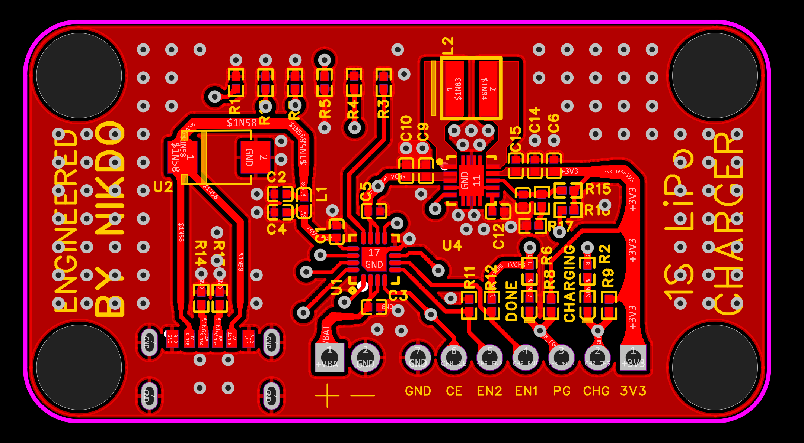
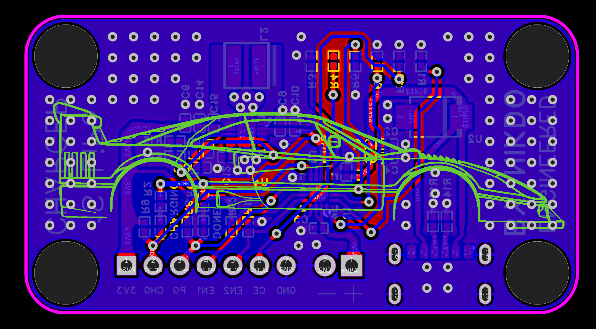

# 1S LiPo Charger

A compact USB-C charger board for single-cell (1S) Li-Po batteries, with a built-in 3.3 V regulator to power your project while it charges.

Author: **Becem Mhamdi** (engineered by Nikdo)

| Top | Bottom |
|:---:|:---:|
|  |  |

## Features

- USB-C input (5 V)
- **BQ24074** charger with power-path management
- **TPS63060** buck-boost converter for a stable 3.3 V output
- CHARGING and DONE status LEDs
- Breakout header for `CE`, `EN1`, `EN2`, `PG`, `CHG` and `3V3`

## Pinout

| Pin | Name | Description |
|-----|------|-------------|
| 1 | 3V3 | Regulated 3.3 V output |
| 2 | CHG | Charge status (active low) |
| 3 | PG | Power good (active low) |
| 4 | EN1 | Input current limit select |
| 5 | EN2 | Input current limit select |
| 6 | CE | Charge enable (active low) |
| 7 | GND | Ground |

The battery connects to the separate `+` / `−` pads. Check polarity before connecting.

### Input current mode (EN1 / EN2)

| EN2 | EN1 | Mode | Input current limit |
|:---:|:---:|------|---------------------|
| 0 | 0 | USB100 | 100 mA |
| 0 | 1 | **USB500 (default)** | 500 mA |
| 1 | 0 | ILIM | **1.3 A** (set by the ILIM resistor) |
| 1 | 1 | Standby | Input disabled (USB suspend) |

By default the board is in **500 mA mode** (`EN1` = high, `EN2` = low) with charging enabled. You can override this from the header.

> **Warning:** In ILIM mode the charging current is **1.3 A**. Check your battery capacity (mAh) first. As a general rule, the charging current should not exceed **1C** (the battery's capacity in mAh, converted to mA). For example, a 1000 mAh battery should not be charged above 1 A, so don't use ILIM mode with it.

## Files

- `1S-LiPo-Charger_Schematic.pdf`: schematic
- `1S-LiPo-Charger.step` / `.obj`: 3D models
- `1S-LiPo-Charger.zip`: manufacturing files

## Safety

For **single-cell** Li-Po / Li-Ion batteries only (4.2 V full charge). Never leave a charging battery unattended.

## License

This project is open source and free for anyone to use, modify and share. It is **not for commercial use**: it is a hobby project, not a product to sell, so please don't use it to make a profit.

(If you want a ready-made license for this, [CC BY-NC-SA 4.0](https://creativecommons.org/licenses/by-nc-sa/4.0/) matches this intent.)

## Author

**Becem Mhamdi**

[GitHub](https://github.com/becem2)

---

  <i>He who spares the wicked, harms the good.</i>

